<!-- Profile README for github.com/tangdarren -->

  

  
  

  <table border="1">
    <tr>
      <td align="center" valign="middle">
        
      </td>
      <td align="left" valign="middle">
        
• M.S. Computer Science at SCU

        
• Software engineer &amp; AI engineer

        
• Based in San Francisco, CA

      </td>
    </tr>
  </table>

 

---

  <a href="https://github.com/tangdarren/stock-market-dashboard">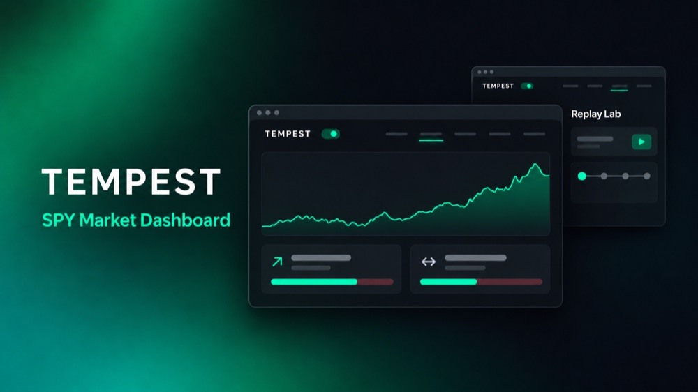</a>
  &nbsp;&nbsp;
  <a href="https://github.com/tangdarren/minispark">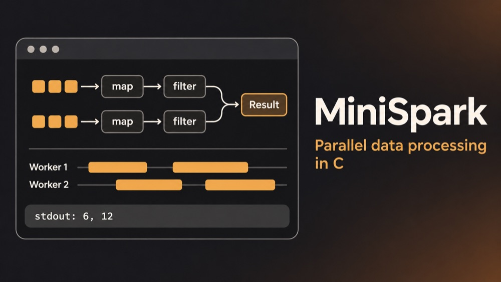</a>
   
  <a href="https://github.com/tangdarren/stock-market-dashboard">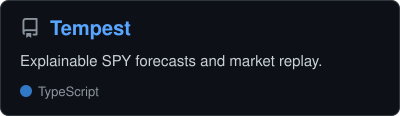</a>
  &nbsp;&nbsp;
  <a href="https://github.com/tangdarren/minispark">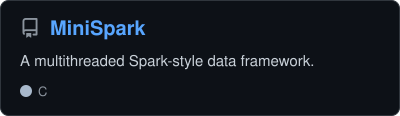</a>

  <a href="https://github.com/tangdarren/musicbloom">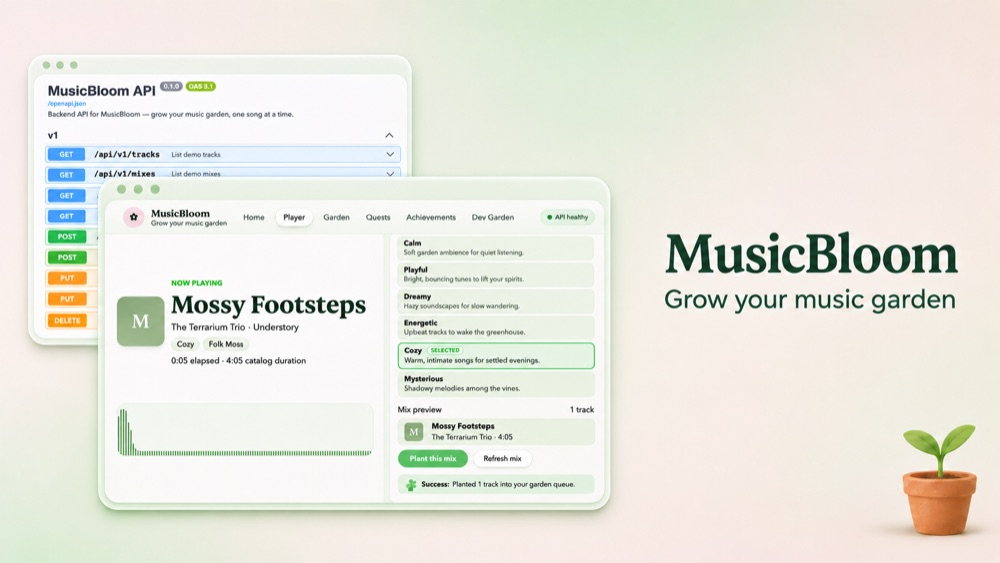</a>
  &nbsp;&nbsp;
  <a href="https://github.com/tangdarren/arc-gpt">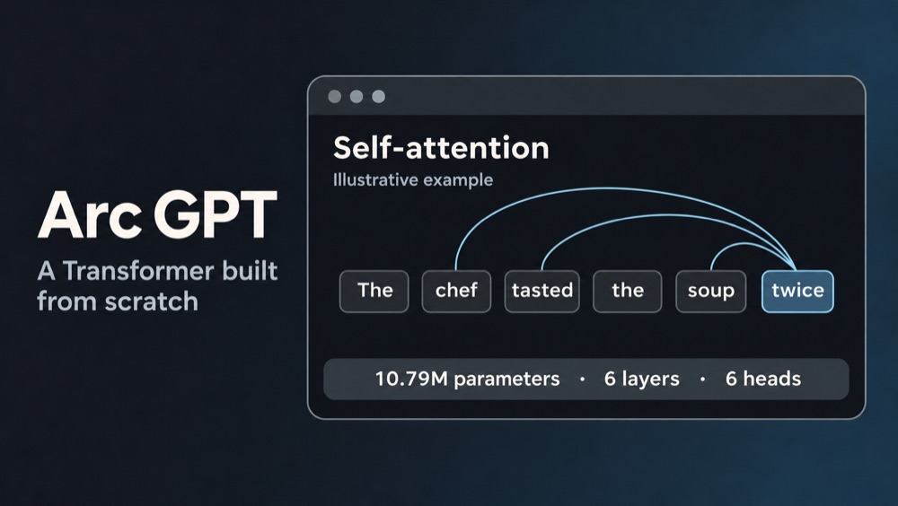</a>
   
  <a href="https://github.com/tangdarren/musicbloom">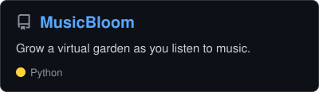</a>
  &nbsp;&nbsp;
  <a href="https://github.com/tangdarren/arc-gpt">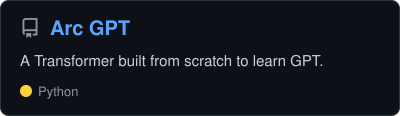</a>

  
  &nbsp;&nbsp;
  <a href="https://github.com/tangdarren/unix_shell">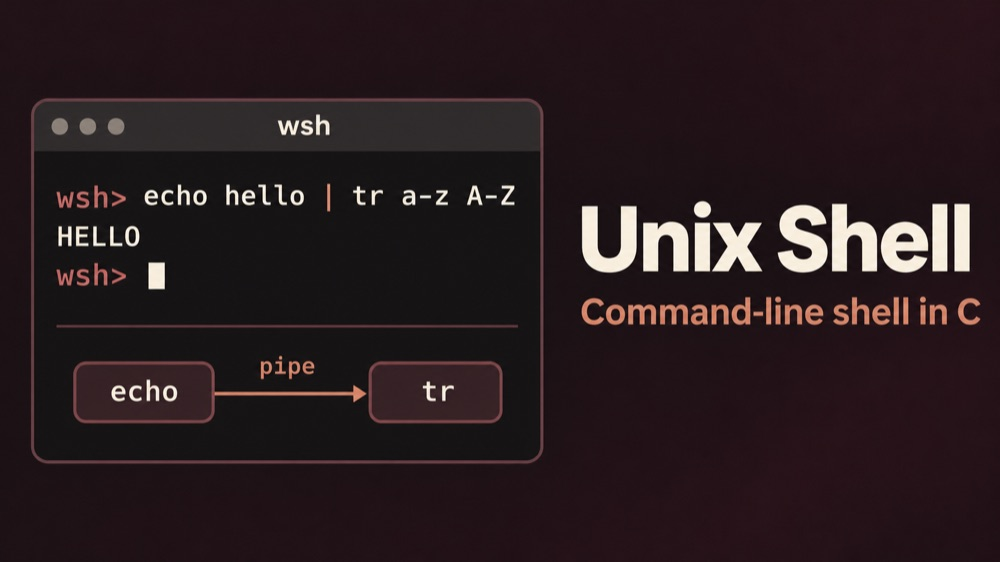</a>
   
  <a href="https://github.com/tangdarren/safecall-website">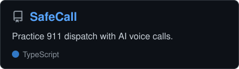</a>
  &nbsp;&nbsp;
  <a href="https://github.com/tangdarren/unix_shell">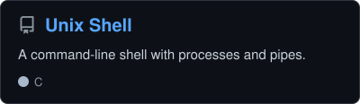</a>

---

<h3 align="center">Tech Toolbox</h3>

#### Languages

  
  
  
  
  
  
  
  
  

#### Full Stack & DevOps

  
  
  
  
  
  
  
  
  
  
  

#### AI & Data

  
  
  
  
  
  
  
  
  
  
  
  

